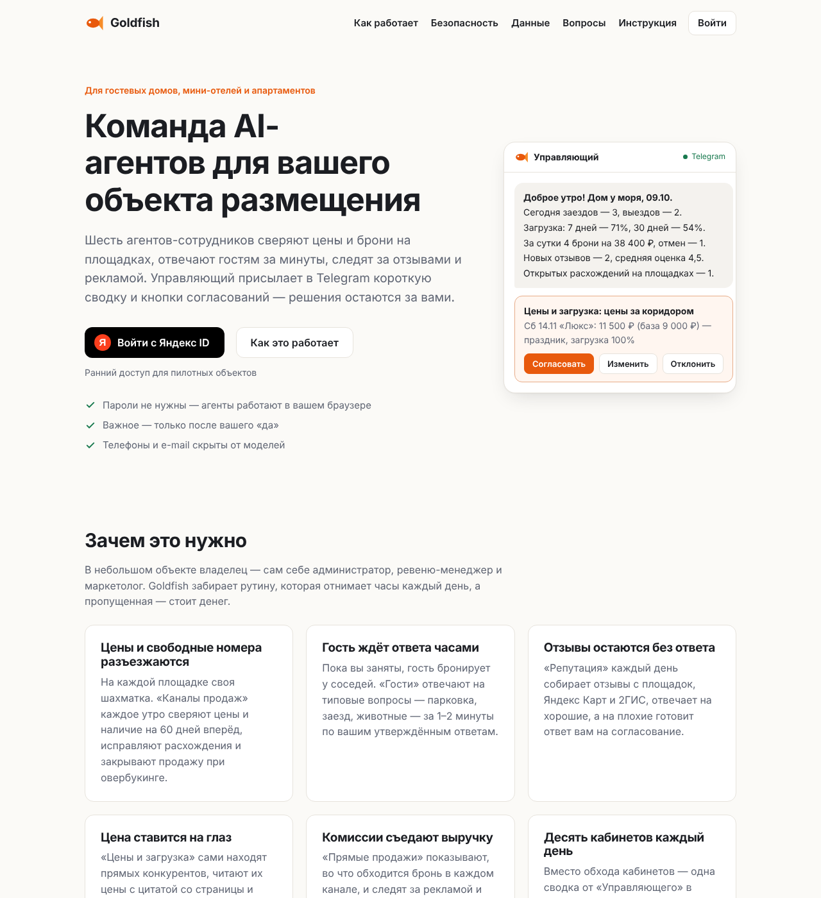
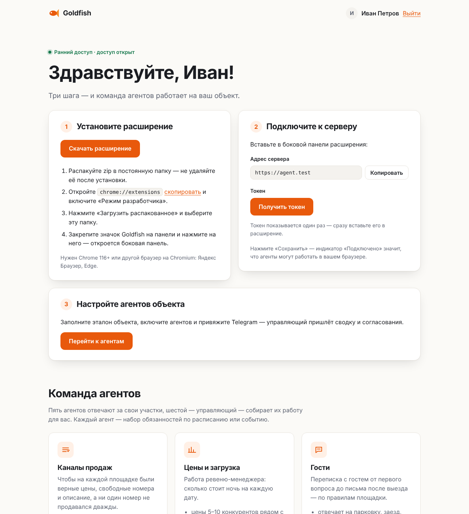
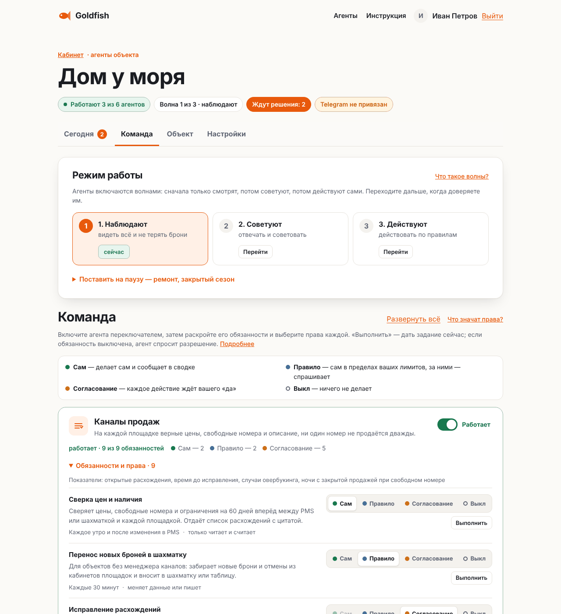
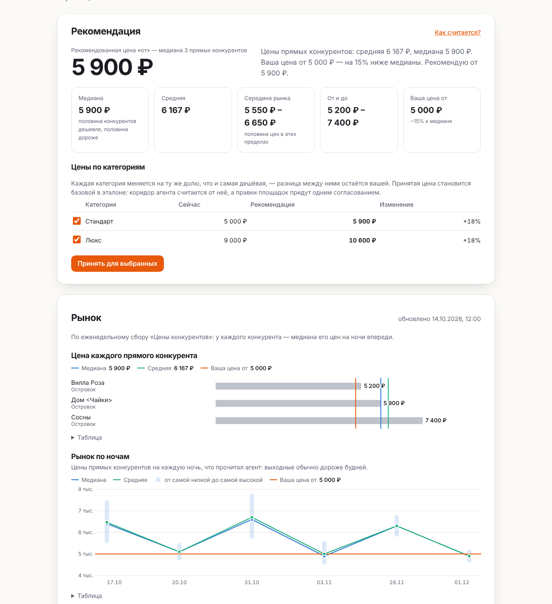

# Goldfish — сайт

Сайт Goldfish — команды AI-агентов для гостевых домов, мини-отелей и апартаментов. Шесть
агентов-сотрудников («Каналы продаж», «Цены и загрузка», «Гости», «Репутация», «Прямые продажи» и
«Управляющий») сверяют площадки, отвечают гостям, следят за отзывами и рекламой, а владельцу
приходят сводка и согласования в Telegram. Сайт — лендинг, вход через Яндекс ID, скачивание
расширения, выдача доступа к серверу и кабинет агентов объекта: команда и права, очередь
согласований, показатели, Telegram, эталон объекта. Позже через этот сайт будут оформляться
подписки; сейчас доступ есть у каждого, кто вошёл.

| Гость                        | После входа                  | Агенты объекта             | Цены                     |
| ---------------------------- | ---------------------------- | -------------------------- | ------------------------ |
|  |  |  |  |

## Как это устроено

```
Пользователь ──► Сайт (этот репозиторий) ──── API оператора ────► Сервер Goldfish
   │  вход через Яндекс ID                    пользователь, токен
   │  скачивает zip, получает токен
   │
   └──► Расширение ──── WebSocket /ws + токен ────► Сервер Goldfish
```

- Страница `/` для гостя — одностраничник со всем, что нужно знать до входа: зачем это нужно, как
  работает (схема «вы → агенты на сервере → расширение → PMS и площадки» и что нужно для работы),
  команда агентов, права и согласования, волны запуска, безопасность, персональные данные (как
  телефон и e-mail превращаются в метки `{{phone_1}}` по пути к модели и обратно, что модель видит
  как есть, что и где хранится и сколько, права пользователя), как начать и вопросы. После входа
  там кабинет, а ниже — команда, безопасность и данные: ссылки шапки и подвала (`/#security`,
  `/#data`) работают в обоих случаях, ссылка на вопрос (`/#faq-passwords`) раскрывает ответ. Сроки
  в таблице «Что и где хранится» — `SESSION_DAYS` сайта и значения по умолчанию сервера Goldfish
  (`AUDIT_RETENTION_DAYS` — 180 дней, `ERROR_RETENTION_DAYS` — 30): поменяли их на сервере —
  поправьте `stored` в [`src/pages/page.ts`](src/pages/page.ts).
- Сайт хранит своих пользователей (Яндекс ID, имя, e-mail) и сессии в PostgreSQL.
- По кнопке «Получить токен» сайт через API оператора Goldfish заводит пользователя
  `yandex:<id Яндекса>` в клиенте «Сайт» и выпускает токен устройства. Токен показывается один раз и
  на сайте не хранится, только его id; новый токен отзывает предыдущий.
- Расширение работает напрямую с сервером Goldfish: в работе агента сайт не участвует и может быть
  недоступен.
- Zip расширения сайт берёт у сервера Goldfish (`/extension/download`, он есть в его Docker-образе)
  или из своего файла `EXTENSION_ZIP`.
- Страница `/agents` — кабинет агентов объекта. Сайт читает и меняет их через API оператора
  Goldfish от имени пользователя (`/admin/users/<clientId>/yandex:<id>/hotel/…`). Вверху — строка
  состояния на любой вкладке: сколько агентов работает, волна, пауза, сколько решений ждёт, привязан
  ли Telegram; каждый пункт ведёт туда, где это меняется. Ниже четыре вкладки (`?tab=`; все в
  странице, `app.js` переключает их без перезагрузки и возвращает на ту же вкладку и место после
  изменения, а без скрипта вкладку открывает сервер):
  - «Сегодня» — первые шаги, очередь согласований, показатели, лента сообщений управляющего;
  - «Команда» — режим работы (волны с подтверждением, что включится, и пауза) и агенты: переключатель
    у каждого, сводка прав его обязанностей, а в раскрытой карточке — права каждой обязанности
    кнопками «Сам / Правило / Согласование / Выкл» (выше потолка обязанности кнопки неактивны),
    описание, расписание, читает она или меняет данные, и «Выполнить»;
  - «Объект» — эталон объекта по разделам (основное, номера, системы и площадки, заезд и правила,
    ответы гостям, цены и допродажи, конкуренты) полями вместо JSON — то, чего форма не показывает,
    сохраняется как было; заполнение «из карточки» (ссылка на карточку объекта на Авито, Яндекс
    Путешествиях и др. или её текст → черновик с найденными полями, которые владелец применяет
    галочками); объявления на площадках (агент ищет объявление объекта, владелец отмечает свои или
    вносит ссылку вручную — тогда площадка подключается сразу, а агент дальше читает объявление по
    ссылке, без поиска); поиск конкурентов: агент сам решает, кто прямой конкурент, и показывает
    причину, владелец может поправить;
  - «Настройки» — режим каждой площадки, привязка мессенджеров (QR-коды и «Отвязать») или
    Telegram, сводка и тихие часы, токен вебхуков.

  Ответ на каждое изменение — сообщение внизу экрана. Изменения принимаются только со страниц самого
  сайта (проверка `Origin`) и только от вошедшего пользователя; отказы сервера (например, поднять
  права выше потолка обязанности) показываются как есть. Как устроены агенты —
  [docs/hotel-agents.md](https://github.com/Bulat89/goldfish/blob/main/docs/hotel-agents.md) в
  репозитории goldfish.

- Страница `/agents/prices` — «Цены»: прямые конкуренты, которых отобрал агент, средняя и медиана
  их цен, рекомендованная цена «от» с пересчётом по категориям и кнопкой «Принять» (меняет базовые
  цены в эталоне), графики — цена каждого конкурента с линиями медианы, средней и вашей цены, рынок
  по ночам и по датам сбора — и таблица доказательств: каждая цена с дословной цитатой со страницы,
  ссылкой и временем чтения. Данные — `GET …/hotel/prices` сервера Goldfish; графики рисует сервер
  сайта в SVG (без библиотек и inline-стилей — их запрещает CSP), подсказки при наведении — `app.js`,
  у каждого графика есть таблица.
- Страница `/help` — инструкция пользователя по всем сценариям (открыта без входа): быстрый старт,
  поиск, вопросы по темам. У каждого ответа свой якорь (`/help#permission`); кабинет и страница
  агентов ссылаются на них из тех мест, которые они объясняют («Как это сделать?»), а на странице
  агентов чек-лист «Первые шаги» показывает, что осталось настроить. Тест `test/help.test.ts`
  проверяет, что все такие ссылки ведут на существующие якоря.

- **Боты в Telegram, MAX и WhatsApp** — отдельный сервер
  [tg_goldfish](https://github.com/Bulat89/tg_goldfish). С `BOTS_URL` в кабинете появляется блок
  «Управляйте агентами из мессенджера»: QR-код на каждый включённый мессенджер. Сайт просит у
  сервера ботов одноразовые коды (`POST /api/owners/<clientId>/yandex:<id>/codes`, токен
  `BOTS_API_TOKEN`) и рисует QR-коды сам — в SVG, без внешних картинок (библиотека
  `qrcode-generator`). Владелец сканирует код телефоном, мессенджер открывает бота, бот привязывает
  чат; дальше в нём согласования, агенты, поручения и задачи, сводка и срочное. Коды одноразовые и
  действуют час — страница выдаёт новые при каждом открытии. Привязанные чаты видны в кабинете и на
  вкладке «Настройки» страницы агентов, там же — «Отвязать». Без ответа сервера ботов страницы
  открываются без QR-кодов.

Код сервера и расширения — в репозитории [goldfish](https://github.com/Bulat89/goldfish).

## Подписки — куда подключать

Доступ решает одна функция — `accessOf(user)` в [`src/access.ts`](src/access.ts); сейчас она
пускает всех. Когда появятся тарифы:

1. Добавить в пользователя план и оплаченный период — новой миграцией в
   [`src/store/migrations.ts`](src/store/migrations.ts) (старые миграции не менять).
2. Считать доступ в `accessOf`: без доступа сайт не выдаёт токен и не отдаёт zip, а в кабинете
   показывает причину.
3. При оплате и окончании периода отправлять состояние на сервер Goldfish:
   `POST /admin/users/<clientId>/yandex:<id>/subscription {"action":"activate"|"suspend","until":…}`.
   Сервер сам отключит расширение и остановит задачи, а после продления всё продолжится с того же
   места — диалоги и память сохраняются.

## Приложение Яндекс ID

1. Создайте приложение на [oauth.yandex.ru](https://oauth.yandex.ru/client/new), платформа —
   «Веб-сервисы».
2. Redirect URI: `https://<домен сайта>/auth/yandex/callback`. Для локального запуска добавьте
   `http://localhost:3000/auth/yandex/callback`.
3. Доступы: логин, имя и фамилия (`login:info`), адрес электронной почты (`login:email`), портрет
   (`login:avatar`).
4. ClientID → `YANDEX_CLIENT_ID`, Client secret → `YANDEX_CLIENT_SECRET`.

## Запуск локально

Нужен Node.js 22 и запущенный сервер Goldfish (его README, раздел «Быстрый старт»).

```bash
npm ci
PUBLIC_URL=http://localhost:3000 \
YANDEX_CLIENT_ID=… YANDEX_CLIENT_SECRET=… \
GOLDFISH_URL=http://localhost:8080 GOLDFISH_ADMIN_TOKEN=<ADMIN_TOKEN сервера Goldfish> \
npm run dev
```

Без `DATABASE_URL` пользователи и сессии живут в памяти и пропадают при перезапуске.

## Развёртывание в Timeweb Cloud

### Вариант А — App Platform, Docker Compose

1. App Platform → новое приложение из этого репозитория, тип «Docker Compose»
   (`docker-compose.yml` в корне). Сайт слушает порт `3000`, проверка состояния — `/healthz`.
2. В разделе переменных приложения задайте: `PUBLIC_URL`, `YANDEX_CLIENT_ID`,
   `YANDEX_CLIENT_SECRET`, `GOLDFISH_URL`, `GOLDFISH_ADMIN_TOKEN` (остальные — по желанию, список
   ниже). Compose подставляет их в контейнер сам — файл `.env` в репозитории не нужен и не должен
   там лежать.
3. База: без `DATABASE_URL` сайт использует PostgreSQL из того же compose. Надёжнее управляемая база
   Timeweb (резервные копии, переживает пересборку) — тогда задайте её строку в `DATABASE_URL`.
   Таблицы сайт создаёт сам при старте.
4. Привяжите домен. `PUBLIC_URL` — этот адрес с `https://`, он же в Redirect URI приложения Яндекс ID.

Если сайт не стартует, в логах приложения будет `Invalid configuration` со списком незаданных
переменных.

### Вариант Б — App Platform, Dockerfile

То же, но тип «Dockerfile» (порт `3000`, `/healthz`): контейнер только с сайтом, база — управляемая
PostgreSQL 16 в `DATABASE_URL` (обязательна), плюс `NODE_ENV=production`.

### Вариант В — облачный сервер с Docker

```bash
git clone https://github.com/Bulat89/site_ai_agent.git && cd site_ai_agent
cp .env.example .env     # заполнить: PUBLIC_URL, YANDEX_*, GOLDFISH_*, SITE_DOMAIN
docker compose -f docker-compose.yml -f deploy/caddy.yml up -d   # + Caddy с сертификатом Let's Encrypt
```

- A-запись домена (`SITE_DOMAIN`) — на IP сервера, порты 80 и 443 открыты. С Caddy сайт слушает
  только `127.0.0.1:3000`.
- Уже есть nginx или другой прокси с TLS — просто `docker compose up -d` и проксируйте на порт
  `3000`; закройте этот порт снаружи файрволом.
- Обновление: `git pull && docker compose up -d --build`.
- Резервная копия: `docker compose exec postgres pg_dump -U site site > site.sql`.

### Связь с сервером Goldfish

- `GOLDFISH_ADMIN_TOKEN` — это `ADMIN_TOKEN` сервера Goldfish, он даёт полный доступ к серверу:
  храните его как пароль. Если `/admin` закрыт от интернета (так советует документация Goldfish),
  разрешите адрес сайта или укажите внутренний адрес в `GOLDFISH_ADMIN_URL`.
- Пользователи сайта видны в панели оператора Goldfish (`/admin/ui`) в клиенте «Сайт» — с именем и
  e-mail. Лимиты и подписку пока можно менять там.
- Предупреждения и ошибки сайта (всё, что он пишет в лог с уровнем `warn` и выше, и падения
  процесса) сайт пачками отправляет в журнал ошибок сервера Goldfish (`POST /admin/errors`, тем же
  `GOLDFISH_ADMIN_TOKEN`). Там они лежат вместе с ошибками сервера и расширения, и их читает AI-
  ассистент через MCP-эндпоинт сервера — см.
  [docs/errors-mcp.md](https://github.com/Bulat89/goldfish/blob/main/docs/errors-mcp.md) в
  репозитории goldfish. Пока сервер недоступен, сайт держит до 200 последних ошибок и отправит их
  позже; выключается `REPORT_ERRORS=false`.
- `/extension/download` на сервере Goldfish открыт без входа. Чтобы zip был доступен только после
  регистрации, закройте этот путь на прокси Goldfish и положите zip на сайт (`EXTENSION_ZIP`).

## Переменные окружения

Сайт читает настройки из окружения (в docker compose — из `.env`, шаблон —
[`.env.example`](.env.example)). Пустое значение (`KEY=`) означает «не задано». Неверное значение
или недостающая обязательная переменная останавливают запуск с ошибкой. Адреса (`*_URL`) — только
`http://` или `https://`: они попадают в ссылки и перенаправления на странице.

В колонке «Обязательна»: **да** — без неё сайт не запустится; **да, если …** — обязательна при
условии; **нет** — есть значение по умолчанию или возможность просто выключена.

### Сайт

| Переменная     | Обязательна                    | По умолчанию  | Описание                                                                                                                                                |
| -------------- | ------------------------------ | ------------- | ------------------------------------------------------------------------------------------------------------------------------------------------------- |
| `NODE_ENV`     | нет                            | `development` | `development`, `production` или `test`; в продакшене — `production` (в Docker-образе уже задано)                                                        |
| `HOST`         | нет                            | `0.0.0.0`     | адрес, на котором слушает сайт                                                                                                                          |
| `PORT`         | нет                            | `3000`        | порт HTTP                                                                                                                                               |
| `LOG_LEVEL`    | нет                            | `info`        | `fatal`, `error`, `warn`, `info`, `debug`, `trace`, `silent`                                                                                            |
| `PUBLIC_URL`   | да                             | —             | адрес сайта, как его открывают пользователи. Из него строится Redirect URI `<PUBLIC_URL>/auth/yandex/callback`; по `https` включаются защищённые cookie |
| `DATABASE_URL` | да, если `NODE_ENV=production` | — (в памяти)  | PostgreSQL: пользователи и сессии. Таблицы создаются при старте. В docker compose задаётся сам                                                          |
| `SESSION_DAYS` | нет                            | `30`          | сколько дней действует вход на сайт (1–365)                                                                                                             |

### Яндекс ID

| Переменная             | Обязательна | По умолчанию              | Описание                                          |
| ---------------------- | ----------- | ------------------------- | ------------------------------------------------- |
| `YANDEX_CLIENT_ID`     | да          | —                         | ClientID приложения Яндекс ID                     |
| `YANDEX_CLIENT_SECRET` | да          | —                         | Client secret приложения Яндекс ID                |
| `YANDEX_OAUTH_URL`     | нет         | `https://oauth.yandex.ru` | адрес OAuth Яндекса; менять только в тестах       |
| `YANDEX_LOGIN_URL`     | нет         | `https://login.yandex.ru` | адрес API профиля Яндекса; менять только в тестах |

### Сервер Goldfish

| Переменная             | Обязательна | По умолчанию   | Описание                                                                                                           |
| ---------------------- | ----------- | -------------- | ------------------------------------------------------------------------------------------------------------------ |
| `GOLDFISH_URL`         | да          | —              | сервер Goldfish, как его вводят в расширении (адрес видит пользователь)                                            |
| `GOLDFISH_ADMIN_URL`   | нет         | `GOLDFISH_URL` | адрес API оператора, если он другой: внутренняя сеть или `http://host.docker.internal:8080` на той же машине       |
| `GOLDFISH_ADMIN_TOKEN` | да          | —              | `ADMIN_TOKEN` сервера Goldfish, не короче 16 символов. Даёт полный доступ к серверу — храните как пароль           |
| `GOLDFISH_CLIENT_ID`   | нет         | —              | клиент (компания) Goldfish для пользователей сайта; без него клиент ищется по `GOLDFISH_CLIENT_NAME` или создаётся |
| `GOLDFISH_CLIENT_NAME` | нет         | `Сайт`         | имя клиента Goldfish, если `GOLDFISH_CLIENT_ID` не задан                                                           |
| `REPORT_ERRORS`        | нет         | `true`         | предупреждения и ошибки сайта уходят в журнал ошибок сервера Goldfish (`POST /admin/errors`); `false` — выключить  |

### Боты в мессенджерах

| Переменная       | Обязательна         | По умолчанию | Описание                                                                                       |
| ---------------- | ------------------- | ------------ | ---------------------------------------------------------------------------------------------- |
| `BOTS_URL`       | нет                 | —            | сервер ботов в Telegram, MAX и WhatsApp (tg_goldfish); с ним в кабинете — QR-коды для привязки |
| `BOTS_API_TOKEN` | да, если `BOTS_URL` | —            | `BOTS_API_TOKEN` сервера ботов, не короче 32 символов                                          |

### Расширение и подвал

| Переменная      | Обязательна                   | По умолчанию | Описание                                                                                                    |
| --------------- | ----------------------------- | ------------ | ----------------------------------------------------------------------------------------------------------- |
| `EXTENSION_ZIP` | нет                           | —            | путь к своему zip расширения; без него (или если файла нет) zip берётся с `GOLDFISH_URL/extension/download` |
| `PRIVACY_URL`   | нет (по 152-ФЗ лучше указать) | —            | политика обработки персональных данных, ссылка в подвале                                                    |
| `SUPPORT_EMAIL` | нет                           | —            | адрес поддержки, ссылка в подвале                                                                           |

### docker compose

Их читает `docker-compose.yml`, а не сайт.

| Переменная          | Обязательна                | По умолчанию | Описание                                                                |
| ------------------- | -------------------------- | ------------ | ----------------------------------------------------------------------- |
| `POSTGRES_PASSWORD` | нет (в продакшене смените) | `site`       | пароль PostgreSQL в контейнере; из него собирается `DATABASE_URL` сайта |
| `SITE_DOMAIN`       | да, если `--profile caddy` | `localhost`  | домен сайта, для которого Caddy получает сертификат Let's Encrypt       |
| `SITE_PORT`         | нет                        | `3000`       | порт на `127.0.0.1`, на котором сайт доступен локальному прокси         |

### Тесты

| Переменная          | Обязательна | Описание                                                   |
| ------------------- | ----------- | ---------------------------------------------------------- |
| `TEST_DATABASE_URL` | нет         | `npm test` дополнительно проверяет хранилище на PostgreSQL |

## Маршруты

| Метод | Путь                        |                                                                            |
| ----- | --------------------------- | -------------------------------------------------------------------------- |
| GET   | `/`                         | лендинг для гостя, кабинет после входа (с QR-кодами ботов)                 |
| GET   | `/auth/yandex`              | переход на Яндекс ID                                                       |
| GET   | `/auth/yandex/callback`     | возврат с Яндекс ID, начало сессии                                         |
| POST  | `/logout`                   | выход                                                                      |
| GET   | `/download`                 | zip расширения (только после входа)                                        |
| POST  | `/api/token`                | новый токен устройства `{token, serverUrl, issuedAt}`                      |
| GET   | `/agents?tab=…`             | агенты объекта (после входа): `today`, `team`, `property`, `settings`      |
| POST  | `/api/agents/settings`      | выключатели: агент, обязанность, площадка, права, пауза, волна, тихие часы |
| POST  | `/api/agents/approvals/:id` | `{decision: approve\|reject\|edit, text?}`                                 |
| PUT   | `/api/agents/profile`       | эталон объекта                                                             |
| POST  | `/api/agents/telegram`      | код и ссылка привязки Telegram                                             |
| POST  | `/api/agents/hook-token`    | токен вебхуков объекта (письма, PMS, мессенджер)                           |
| POST  | `/api/bots/unlink`          | `{channel, chatId}` — отвязать чат от бота в мессенджере                   |
| GET   | `/healthz`, `/readyz`       | живость и готовность (с проверкой базы)                                    |

## Безопасность

- Вход — authorization code с PKCE и `state`. Токен Яндекса используется один раз, чтобы прочитать
  профиль, и не сохраняется.
- Cookie — `HttpOnly`, `SameSite=Lax`, по `https` с префиксом `__Host-` (поддомен не подложит свою
  сессию). Сессии хранятся в базе хешем.
- Изменяющие запросы (`/api/token`, `/api/agents/*`, `/logout`) принимаются только со страниц
  самого сайта (проверка `Origin`); CSP без inline-скриптов, страница не встраивается во фреймы.
- Персональные данные (имя, e-mail) хранятся в PostgreSQL — держите базу в России (152-ФЗ) и укажите
  `PRIVACY_URL`.
- Выдача токенов сериализуется в памяти процесса — запускайте одну реплику.

## Проверки

```bash
npm run typecheck
npm test                                                     # Яндекс ID и сервер Goldfish — фейковые
TEST_DATABASE_URL=postgres://… npm test                      # + хранилище на PostgreSQL
npm run format:check
```
